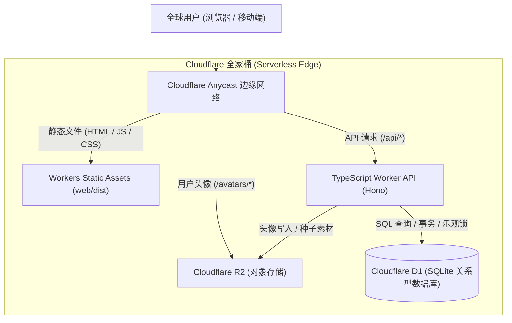

# 设定创作器 v6 —— 纯 Cloudflare Serverless 全家桶部署指南 (`docs/CLOUDFLARE.md`)

本文档介绍如何将 **设定创作器 (Worldbuilding Studio)** 以 **纯 Cloudflare Serverless 全家桶（方案三）** 的形态部署上线。

该方案实现 **零物理服务器（No VPS）、零月费（利用 Cloudflare 永久免费额度）、全球 Anycast CDN 加速与自动化全球高可用**。

---

## 1. 架构总览



### 核心选型与对应关系

| 业务模块 | 原自建架构 | Cloudflare Serverless 全家桶 | 优势 |
| :--- | :--- | :--- | :--- |
| **前端应用** | Nginx / Go 静态托管 | **Workers Static Assets (SPA)** | 全球 300+ 边缘节点缓存，毫秒级就近响应 |
| **API 服务** | Go 原生常驻进程 (`:8080`) | **Cloudflare Workers (TypeScript + Hono)** | 无冷启动、自动弹性伸缩、无需维护 Linux 进程 |
| **关系型数据** | 本地 SQLite WAL (`app.db`) | **Cloudflare D1** (Serverless SQLite) | 100% 沿用 SQLite 语法与索引，全球分布式副本 |
| **头像/素材存储** | 本地磁盘目录 (`data/avatars/`) | **Cloudflare R2** (对象存储) | 零出站流量费（Free egress），高持久度 |
| **密码与防爆破** | bcrypt + HMAC 算术验证码 | **Web Crypto + bcryptjs + Challenge** | 原生 Web 标准支持，无第三方外部依赖 |

---

## 2. 部署前准备

1. **注册 Cloudflare 账号**：[cloudflare.com](https://dash.cloudflare.com/)
2. **环境要求**：Node.js `>= 22.0.0` 及 `npm`。
3. **登录 Cloudflare CLI**：
   ```bash
   npx wrangler login
   ```
   （终端会弹出浏览器授权页面，点击确认即可）

---

## 3. 一步步线上部署指南

### 第一步：安装依赖与构建前端

在仓库根目录执行：
```bash
# 1. 安装根目录部署工具与 Worker 依赖
npm install

# 2. 安装前端依赖并打包 Vue 3 静态产物到 web/dist
cd web && npm install && cd ..
npm run build:web
```

---

### 第二步：创建 Cloudflare D1 数据库

执行以下命令在 Cloudflare 创建云端 D1 数据库：
```bash
npx wrangler d1 create creator-db
```

命令输出类似如下信息：
```text
[[d1_databases]]
binding = "DB"
database_name = "creator-db"
database_id = "xxxxxxxx-xxxx-xxxx-xxxx-xxxxxxxxxxxx"
```

**关键操作**：
打开根目录的 [wrangler.toml](file:///data/creator/wrangler.toml)，将输出的 `database_id` 替换进去：
```toml
[[d1_databases]]
binding = "DB"
database_name = "creator-db"
database_id = "你的真实-database-id"
migrations_dir = "./migrations"
```

---

### 第三步：执行数据库表结构迁移（D1 Remote Migrations）

本项目迁移文件已经统一整理在 `migrations/` 目录下（`0001_init.sql` 至 `0007_creator_management_ai_guards.sql`）：

已有平台升级请先阅读 [创作管理与 AI 防护升级说明](CLOUDFLARE_CREATOR_UPGRADE.md)，备份并确认恰好一名现有超级管理员后执行：

```bash
npm run d1:preflight:remote
npm run d1:migrate:remote
```

空数据库须先完成上一版本 `0001`–`0006` 的建表和账号注册，由运维明确确认唯一超级管理员后再执行 `0007`。没有或存在多名超级管理员时，本版会停止迁移，不会自动选择账号。

---

### 第四步：创建 Cloudflare R2 头像存储桶

创建用于存储用户上传头像的 R2 存储桶：
```bash
npx wrangler r2 bucket create creator-avatars
```

---

### 第五步：设置生产环境变量与安全密钥

建议通过 `wrangler secret` 设置生产密钥（避免明文提交到 Git）：

```bash
# 1. 设置 JWT/HMAC 签名与加密专属密钥（生成32位随机字符串）
openssl rand -hex 32 | npx wrangler secret put SECRET_KEY

# 2. 首次管理员账号通过受控数据库/管理脚本设置，不再根据邮箱自动提权
# 须在第三步的 0007 迁移之前完成注册与确认；迁移后禁止分配超级管理员
# 由受控运维流程确认唯一账号后设置 is_admin=1、is_super_admin=1
# 例如（确认邮箱后执行）：
# npx wrangler d1 execute creator-db --remote --command "UPDATE users SET is_admin=1, is_super_admin=1 WHERE email='you@example.com'"

# 3. (可选) 如需启用平台公共免费 AI 生成能力，配置 OpenRouter 密钥:
npx wrangler secret put OPENROUTER_API_KEY
```

---

### 第六步：一键打包并部署到 Cloudflare

只需运行一条命令：
```bash
npm run deploy
```

构建完成后，Wrangler 会输出你的专属 Worker 线上地址，例如：
```text
Uploaded creator (3.21 sec)
Deployed creator triggers (0.45 sec)
  https://creator.<你的子域>.workers.dev
Current Deployment ID: xxxxxxxx-xxxx-xxxx-xxxx-xxxxxxxxxxxx
```

打开该网址，即可看到完整的设定创作器 Web 界面！

---

### 第七步：绑定自定义域名（可选，强烈推荐）

1. 在 Cloudflare 控制台将你的域名（如 `creator.yourdomain.com`）DNS 托管在 Cloudflare；
2. 进入 Cloudflare 控制台 -> **Workers & Pages** -> 点击 **`creator`** -> **Settings** -> **Domains & Routes**；
3. 点击 **Add** -> **Custom Domain**，输入你的域名（如 `creator.yourdomain.com`）；
4. Cloudflare 会自动申请全球 SSL 证书并秒级生效。

---

## 4. 本地仿真调试（Local Development）

在不连接线上生产环境的情况下，支持纯本地离线仿真运行：

```bash
# 1. 将数据表结构应用到本地轻量 SQLite
npm run d1:migrate:local

# 2. 启动本地仿真开发服务器（包含 Worker API、本地 D1、本地 R2、前端静态资源热更新）
npm run dev
```

浏览器访问 `http://localhost:8787` 即可实时测试和断点调试。

---

## 5. 日常运维与数据备份

### 1. 导出与备份云端数据库 (D1 Backup)

```bash
# 将线上 D1 数据库完整导出为 SQL 备份文件
npx wrangler d1 export creator-db --remote --output ./backup-$(date +%Y%m%d).sql
```

### 2. 恢复数据库 (D1 Restore)

```bash
# 导入 SQL 备份到线上 D1 数据库
npx wrangler d1 execute creator-db --remote --file ./backup-YYYYMMDD.sql
```

### 3. 查看实时访问日志

```bash
npx wrangler tail
```

---

## 6. 免费配额与成本分析

Cloudflare 为个人创作者提供了极具吸引力的免费额度：

| 产品 | Cloudflare 免费计划额度 (Free Tier) | 针对本项目的承受能力 |
| :--- | :--- | :--- |
| **Cloudflare Workers** | 100,000 次请求 / 天 | 日均支持数千次设定集保存与浏览 |
| **Cloudflare D1** | 5,000,000 次读取 / 天<br>100,000 次写入 / 天<br>存储上限 500 MB (文本) | 可容纳约 1~2 亿字中文设定集数据 |
| **Cloudflare R2** | 10 GB 存储空间<br>A 类操作 (写入) 100 万次/月<br>**出站流量费永久 0 元** | 可存放约 50,000 张高清创作者头像 |
| **Workers Assets** | 静态资产无限制免费分发 | 零带宽账单困扰 |

> 若未来业务规模爆发，升级到 Cloudflare Workers Paid 仅需 **\$5/月**，D1 扩展至 10GB+，几乎无须担心运维压力。
